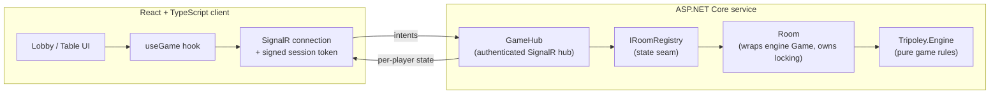

# Tripoley

A multiplayer, server-authoritative web version of the classic card game **Tripoley** (also sold as Michigan Rummy or Tripoli), built as a full-stack portfolio project on **.NET 10** and **React**.

[](https://github.com/Fleerless/Tripoley/actions/workflows/ci.yml)


**Live demo: [tripoley.jeffreyfleer.com](https://tripoley.jeffreyfleer.com)**

Players share one board over a real-time connection and compete across a round of Michigan Rummy. The server owns every rule: clients send *intents* ("play this card", "claim this seat"), and the engine decides what is legal. Each player is only ever sent their own hand, so the hidden information that makes the game work cannot be read off the wire.

## Screenshots

> The centerpiece is an original 1980s-vibe mat design. See the [live demo](https://tripoley.jeffreyfleer.com) for the full experience.

## What this project demonstrates

- **Server-authoritative real-time multiplayer.** A SignalR hub validates every move against a pure game engine, so the client is a renderer, not a referee.
- **Hidden information done correctly.** Opponents' hands and the undealt widow are never sent to a client, only counts. Each connection receives a per-player projection of the same shared state.
- **Resilience under real network conditions.** Players reconnect into their existing seat after a drop, refresh, or network blip, backed by a stable signed session identity and jittered client retry.
- **A tested, gated codebase.** xUnit and Vitest suites run on every push behind an 85% line-coverage floor, code-style verification, and a generated-contract check that keeps the C# and TypeScript types in sync.
- **Shipped, not just built.** Deployed to AWS through a GitHub Actions pipeline using OIDC (no long-lived cloud keys).

## Tech stack

| Layer        | Choice |
| ------------ | ------ |
| Game engine  | C# 14 class library (`Tripoley.Engine`), pure logic, no I/O |
| API / realtime | ASP.NET Core (.NET 10) minimal hosting + SignalR (`Tripoley.Api`) |
| Auth         | Anonymous signed JWT session tokens (stable identity for reconnect) |
| Client       | React + TypeScript + Vite + `@microsoft/signalr` |
| Tests        | xUnit (.NET) and Vitest (web), coverage gated by coverlet |
| CI/CD        | GitHub Actions: build, test, lint, format, contract check, deploy |
| Hosting      | AWS Elastic Beanstalk (API) + S3 and CloudFront (client), `us-west-2` |

## Architecture



### Server-authoritative gameplay and hidden hands

The engine is a pure library with no I/O: given a game state and a proposed move, it returns the next state or rejects the move. The hub never trusts the client with rules. After each accepted intent it broadcasts a public game view to the room and sends every player a private `SelfView` containing only that player's own cards. There is no payload a client could inspect to learn an opponent's hand.

### Project layout

| Project | Role |
| ------- | ---- |
| `Tripoley.Engine` | Game rules and state transitions. Pure, deterministic, heavily unit-tested. |
| `Tripoley.Api` | SignalR hub, room lifecycle, session auth, and the hidden-hand projection. |
| `Tripoley.ContractGen` | Reflects over the API's DTOs and emits the client's TypeScript contracts. |
| `tripoley-web` | React client: lobby, table, and the 80s mat. |
| `*.Tests` | xUnit test suites for the engine and the API. |

### Type-safe wire contracts

The server's contract records are the single source of truth. `Tripoley.ContractGen` reflects over them and generates `tripoley-web/src/api/contracts.ts`, and CI fails if the committed file drifts from the C# types. This removes a whole class of client/server mismatch bugs without hand-maintaining two type definitions.

### State, identity, and reconnect

Room and game state live in memory behind the `IRoomRegistry` seam, so the hub depends on an interface rather than a concrete store. Each client mints an anonymous, signed JWT on first load and keeps it; that token, not the transient SignalR connection id, is the player's identity. A dropped connection therefore returns to the same seat, and an `IdleRoomSweeper` background service reaps rooms only once every member has been gone past a timeout.

### Scaling and reconnect boundaries

Room and game state is held in memory on a single server instance (an intentional decision for this stage: no database until match history or horizontal scaling actually requires one). This shapes what reconnect can and cannot do:

- **Client drops reconnect cleanly.** A player keeps a stable identity (a signed session token), so a dropped connection, refresh, or brief network blip reclaims the same seat. The idle sweeper evicts rooms only after every member has been disconnected past its timeout.
- **A server restart or redeploy ends in-progress games.** State lives in process memory, so it does not survive a restart; the session token outlives the room but the room is gone.
- **Running more than one instance needs sticky sessions or a backplane.** Rooms are instance-local, so a reconnect that lands on a different instance would not find the room. Before scaling past one instance, enable sticky sessions on the load balancer (or add a Redis backplane or shared store). The `IRoomRegistry` seam is in place so a shared store can slot in without rewriting the hub.

## Testing and quality

Tests are written to pin real rules and behavior, not to chase a coverage number. The standards enforced in CI:

- **85% line coverage floor** on every test project (coverlet), with an undercovered-class report in the build summary. Serialization DTOs and the composition root are excluded because they have no branching worth asserting.
- **Code style verification** with `dotnet format` and ESLint, so formatting never lands in review.
- **Generated-contract check** that regenerates the TypeScript contracts and fails on drift.
- **Conventional commits** enforced by commitlint, with releases and the changelog driven by release-please.

## CI/CD and deployment

Every push and pull request runs build, test with the coverage gate, web lint/test/build, .NET format verification, and the contract check. Merges to the deployment branches trigger a GitHub Actions pipeline that publishes the API container to Elastic Beanstalk and the static client to S3 and CloudFront. AWS access uses GitHub's OIDC provider, so there are no long-lived credentials stored in the repository.

## Running locally

Prerequisites: the **.NET 10 SDK** and **Node 22+**.

```bash
# API (http://localhost:5106)
dotnet run --project Tripoley.Api

# Web client (http://localhost:5173), in a second terminal
cd tripoley-web
npm install
npm run dev
```

A development JWT signing key ships in `appsettings.Development.json`; production supplies its own via configuration.

```bash
# Run all tests with the coverage gate
dotnet test Tripoley.slnx
cd tripoley-web && npm run test:coverage

# Regenerate the TypeScript contracts after changing an API DTO
dotnet run --project Tripoley.ContractGen -- tripoley-web/src/api/contracts.ts

# Build the API container image
docker build -t tripoley-api .
```

## Game rules

Gameplay follows the standard Tripoli / Tripoley rules published by Pagat: <https://www.pagat.com/stops/3in1.html>. The current release implements the Michigan Rummy phase end to end. The engine already models all three phases (Hearts and Poker) structurally; those phases are next on the roadmap.

## Roadmap

- [x] Game engine with a tested Michigan Rummy ruleset
- [x] SignalR API with lobby, rooms, hidden hands, and reconnect
- [x] React client with an original 80s mat design
- [x] CI with a coverage gate, and deployment to AWS
- [ ] Hearts and Poker phases
- [ ] Optional bot opponent and `docker compose` for one-command local startup
- [ ] Persistence for match history and accounts

## License

See [LICENSE](LICENSE).
